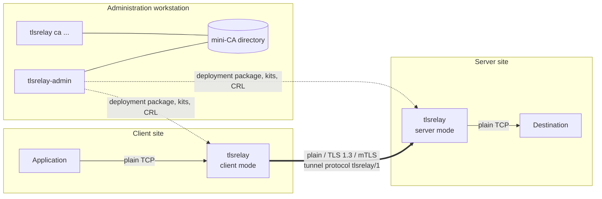
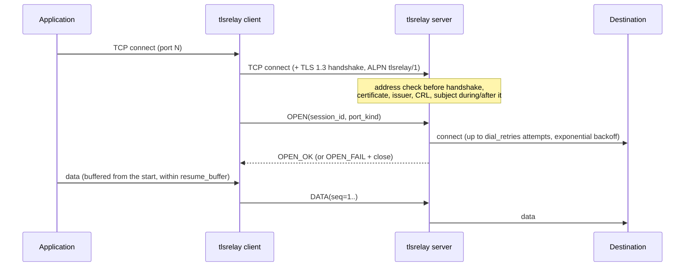
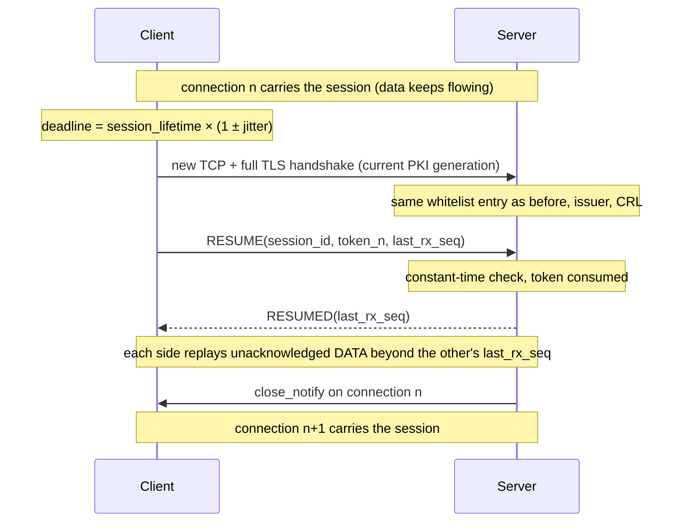
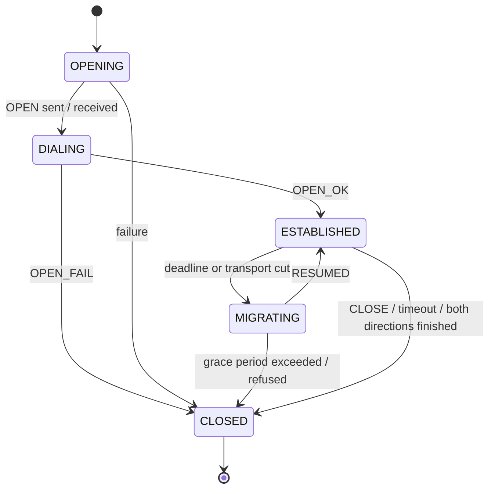
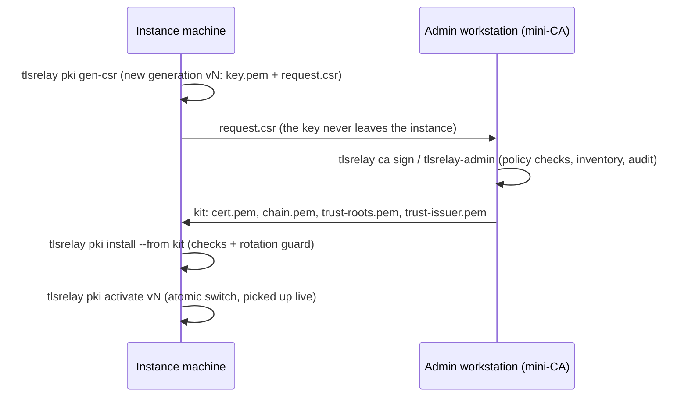

# tlsrelay — Design document

> English design reference for the complete solution: the `tlsrelay` service, the `tlsrelay-testkit` test tool and the `tlsrelay-admin` editor (deliveries 1.0 and 1.1).
> The normative behaviour is specified in [SPEC.md](SPEC.md) (French); the project plan, decisions and test strategy are in [PLAN.md](PLAN.md). Where this document and the SPEC differ, the SPEC prevails.

## Contents

1. [Purpose and scope](#1-purpose-and-scope)
2. [System context](#2-system-context)
3. [Key design decisions](#3-key-design-decisions)
4. [Architecture](#4-architecture)
5. [Security design](#5-security-design)
6. [Tunnel protocol `tlsrelay/1`](#6-tunnel-protocol-tlsrelay1)
7. [Channel engine and data path](#7-channel-engine-and-data-path)
8. [PKI design](#8-pki-design)
9. [Configuration model](#9-configuration-model)
10. [Operations: service, administration, observability](#10-operations-service-administration-observability)
11. [The `tlsrelay-admin` editor](#11-the-tlsrelay-admin-editor)
12. [Build, dependencies and packaging](#12-build-dependencies-and-packaging)
13. [Quality assurance](#13-quality-assurance)
14. [Known limitations and future work](#14-known-limitations-and-future-work)
15. [Glossary](#15-glossary)

---

## 1. Purpose and scope

`tlsrelay` carries TCP connections from an application to a destination across an untrusted network. It always works **in pairs**: a client-mode instance next to the application and a server-mode instance next to the destination. Between the two, traffic can be protected at three levels, each exposed on its own port:

| Port kind | Name | Protection between the two relays |
|---|---|---|
| 1 | `plain` | None (plain relay, still using the tunnel protocol) |
| 2 | `tls` | TLS 1.3: encryption and server authentication |
| 3 | `mtls` | TLS 1.3 with client certificates: mutual authentication, plus peer whitelisting by address and certificate subject |

Beyond a plain TLS proxy, the solution provides:

- **Transparent renegotiation**: long-lived connections are periodically moved onto a fresh TLS connection (full handshake, current certificates) without the application noticing; the same mechanism resumes a session after a network cut.
- **Hot PKI rotation**: keys, certificates, intermediate CAs and even the root can be replaced while channels stay open.
- **Peer control**: whitelist (address ranges, ports, certificate subjects) and certificate revocation lists (CRL), both reloaded live.
- **Service lifecycle**: systemd and Windows services, named instances, graceful drain, a local administration channel and Prometheus metrics.
- **Tooling**: a command-line mini-CA, a test and acceptance toolkit, and a Windows graphical editor for configurations and the CA.

Out of scope: load balancing between several destinations, UDP, HTTP awareness, remote administration over the network, and any key escrow.

### 1.1 Deliverables

| Deliverable | Platforms | Role |
|---|---|---|
| `tlsrelay` | Windows x64, Linux x86-64 | The relay (client or server mode), service management, instance-side PKI commands, mini-CA |
| `tlsrelay-testkit` | Windows, Linux | Echo destination, load, throughput and latency generators, network disturbance proxy, test PKI factory |
| `tlsrelay-admin` | Windows (built and tested on Linux in CI) | Qt 6 editor: configuration, whitelist, deployment packages, mini-CA management |
| Packages | `.deb`, `.rpm`, `.msi` | Linux packages (service, testkit); Windows MSI with optional *testkit* and *tlsrelay-admin* features |

### 1.2 Target platforms

- Windows 10/11 and Windows Server 2019 or later, 64-bit; OpenSSL 3.5 LTS shipped in the MSI.
- Ubuntu 22.04/24.04, Debian 12, RHEL 9 and rebuilds (Rocky, Alma); the distribution's OpenSSL (3.0 or later), patched by the distribution.

---

## 2. System context

```
                     untrusted network
 App ──TCP──► [tlsrelay client] ══ transport: plain | TLS 1.3 | mTLS ══► [tlsrelay server] ──TCP──► Destination
               listens on 3 local ports          tunnel protocol          listens on 3 ports       single address:port
               (one per protection level)        "tlsrelay/1"             whitelist, CRL
```



| Role | Client | Server |
|---|---|---|
| Listens | Up to 3 local plain ports for the application | Up to 3 ports: plain, TLS, mTLS |
| Connects to | The server (one `upstream` per port) | The single destination, with retries |
| Presents a certificate | mTLS port: certificate issued by the *Clients CA* | TLS and mTLS ports: certificate issued by the *Servers CA* |
| Verifies | Server chain to a trusted root **and** issued by the *Servers CA*; host name or IP | mTLS: chain to a trusted root, issued by the *Clients CA*, subject and address in the whitelist; CRL |
| Renegotiation | Initiates it | Requires it; closes the session if it does not happen in time |

The peer of a relay is always another `tlsrelay`: the tunnel protocol is mandatory and is negotiated through ALPN (`tlsrelay/1`). An application cannot connect directly to a server-mode port.

---

## 3. Key design decisions

| Topic | Decision | Rationale |
|---|---|---|
| Language and runtime | C++20 with coroutines, standalone Asio (IOCP on Windows, epoll on Linux) | Native performance, no runtime dependency; coroutines keep the per-channel logic sequential and readable |
| TLS stack | OpenSSL 3 driven through **memory BIOs** (not `asio::ssl` streams) | Full control of the session: half-close (`close_notify` in one direction only), keying-material exporter for resume tokens, explicit flushing |
| OpenSSL linkage | Dynamic; OpenSSL 3.5 LTS shipped on Windows, distribution OpenSSL on Linux | Security fixes from the platform vendor on Linux; LTS on Windows |
| Other dependencies | Asio, CLI11, spdlog (with fmt), yaml-cpp: pinned by commit and linked statically in Linux packages; vcpkg on Windows | One binary per platform family, independent of distribution library versions |
| Tunnel | Own framing protocol on top of TCP/TLS with sequence numbers and cumulative ACKs | Enables lossless migration of a channel to a new transport connection |
| One session per channel | Each application connection gets its own transport connection and tunnel session | Isolation, simple flow control, per-channel renegotiation; no head-of-line blocking between channels |
| Renegotiation | New TCP connection + full TLS handshake, then `RESUME` with a token derived from the previous connection (RFC 8446 exporter) | Picks up new certificates and keys; resume cannot be replayed or hijacked without the previous TLS session |
| PKI | Versioned generations on disk (`v1`, `v2`, … + `current` pointer); one `SSL_CTX` per generation | Atomic switch; existing connections keep the generation they were opened with until they renegotiate |
| Rotation safety | Rotation guard: a new generation must share a root with the current one and chain to a currently trusted root | Makes it impossible to cut peers by activating an incompatible PKI; root change is a 3-step procedure |
| Revocation | Whitelist removal (immediate) and CRLs published by the mini-CA, applied by the service | Two levels: operational (whitelist) and cryptographic (CRL) |
| Administration | Local channel only (Unix socket / named pipe), no network listener | No new remote attack surface |
| Metrics | Prometheus text format served on the admin channel | Collected by an existing exporter (e.g. node_exporter textfile) |
| Editor | Qt 6 Widgets, LGPLv3 dynamic linking; reuses the core library | Same validation rules as the service by construction |
| Editor validation | The editor serialises raw field text to YAML and runs the **service loader** on it | Identical error paths and messages ("editor/service parity"), no duplicated rules |
| Saving | Normalised rewrite; comments are not preserved; `.bak` kept; atomic rename | Simple and predictable; the diff preview makes changes explicit |
| Licensing | tlsrelay proprietary; third-party notices shipped; Qt under LGPLv3 | Decided with the project owner |

---

## 4. Architecture

### 4.1 Components

```
             ┌──────────────────────────────────────────┐
             │             libtlsrelay-core              │  C++20, OpenSSL 3, Asio, yaml-cpp, spdlog
             │  config · whitelist · pki · tls · tunnel  │
             │  relay (channel, service) · admin · log   │
             └──────┬───────────────┬──────────────┬─────┘
                    │               │              │
           ┌────────▼──────┐ ┌──────▼───────┐ ┌────▼──────────────┐
           │   tlsrelay    │ │tlsrelay-     │ │  tlsrelay-admin   │
           │ (CLI + relay) │ │testkit       │ │  (Qt 6 editor)    │
           │ Win + Linux   │ │Win + Linux   │ │  Windows          │
           └───────────────┘ └──────────────┘ └───────────────────┘
```

All business logic lives in the static library `libtlsrelay-core`. The executables are thin: argument parsing, platform integration (service managers, passphrase input) and presentation.

### 4.2 Core modules

| Module | Main types | Responsibility |
|---|---|---|
| `config` | `Config`, `load_config_string`, `validate`, `to_yaml` | YAML parsing with all errors collected (path + message), consistency rules, normalised writing |
| `whitelist` | `Whitelist`, `Peer`, `PeerSpec`, `diff` | Peer list parsing, address/port/subject matching, change diff for logs, writing |
| `units`, `endpoint` | `parse_duration`, `parse_size`, `Endpoint` | Value formats (`30s`, `4MiB`, `10%`, `host:port`, IPv6 in brackets) |
| `pki/generation` | `Generation`, `load_generation`, `rotation_guard`, `activate` | Loading and checking a PKI generation, rotation guard, atomic activation |
| `pki/request` | `generate_csr`, `install` | Instance side: key + CSR generation, kit installation |
| `pki/authority` | `init_authority`, `sign_request`, `revoke_certificate`, `publish_crl`, `describe_authority`, `write_root_transition` | Mini-CA: hierarchy, signing policy, inventory, CRLs, root change preparation |
| `pki/revocation` | `RevocationList`, `load_revocations` | CRL loading and verification for a generation; revocation lookups |
| `pki/audit` | `append_audit`, `read_audit` | Hash-chained audit log of CA operations |
| `tls` | `Context`, `Revocations`, RAII wrappers | `SSL_CTX` per generation and port kind, peer verification callback (expected issuer, CRL), session creation |
| `tunnel` | frame encoder/decoder | `tlsrelay/1` framing, strict validation, escaping of peer-supplied text |
| `relay/stream` | `Stream` | TCP or TLS stream over memory BIOs: handshake, read, serialized writes, half-close, exporter |
| `relay/dial`, `relay/transport` | dialing with retries, deadlines | Outgoing connections, timeouts |
| `relay/channel` | `Channel` | Per-channel state machine, flow control, renegotiation and resume |
| `relay/service` | `Service` | Listeners, accept loops, PKI/whitelist/CRL watching and reloading, drain, admin commands, status and metrics |
| `admin` | `admin::Server`, request parser | Local administration channel (Unix socket / named pipe), instance lock |
| `logging` | categories `activity` and `config` | Structured logs (text or JSON), live level changes, log reopening |
| `text_diff` | `diff_lines`, `format_diff` | Line diff for the editor's save preview |
| `system/notify` | `notify` | systemd readiness notification (`sd_notify` protocol, no libsystemd dependency) |

### 4.3 Process and threading model

- A `Service` owns one `asio::io_context` run by *N* threads (default: number of cores).
- Each port has an acceptor on its own strand; each channel runs entirely on **its own strand**, so channel state needs no locks.
- Service-wide state is touched on a dedicated *control* strand (signals, reloads, watching) or behind small mutexes (current PKI generation and contexts, whitelist, revocations, channel registry).
- Shared, read-mostly objects are immutable and swapped atomically by `shared_ptr` (generations, whitelists, revocation lists, TLS contexts). A connection holds a reference to the context — hence the generation — it was opened with; a retired generation is freed when its last connection closes.
- A watcher coroutine compares the content of `current`, the whitelist file and `crl.pem` every 2 s (content comparison, independent of timestamp precision).

### 4.4 Source tree

```
src/core/       libtlsrelay-core (include/tlsrelay/…, src/…)
src/app/        tlsrelay executable: CLI, services (platform_linux.cpp, platform_windows.cpp), passphrase input
src/testkit/    tlsrelay-testkit: traffic generators, disturbance proxy, test PKI
src/admin/      tlsrelay-admin: Qt widgets and dialogs, deployment export
tests/          GoogleTest suites, Qt tests (tests/admin), lifecycle scripts, performance and soak scripts
fuzz/           libFuzzer targets (frame, config, whitelist, DN, CSR, admin request)
tools/          static analysis wrappers, hardening checks, acceptance scripts (recette*.ps1)
packaging/      Linux build and install-test scripts, maintainer scripts
cmake/          compiler options, dependencies (system / fetched), packaging
docs/           SPEC, PLAN, INSTALLATION, EXPLOITATION, EDITEUR, RECETTE, PENTEST, this document
```

---

## 5. Security design

### 5.1 Threat model (summary)

| Asset | Threat | Countermeasures |
|---|---|---|
| Relayed data | Eavesdropping, tampering on the network | TLS 1.3 only, AEAD suites, certificate verification on both sides (mTLS) |
| Server-side destination | Access by unauthorised clients | mTLS with expected issuer, whitelist (address **and** subject in the same entry), checks repeated at every renegotiation, CRL |
| Client-side application | Connection to a rogue server | Chain to a trusted root, expected issuer (*Servers CA*), host name / IP check, ALPN `tlsrelay/1` |
| Long-lived sessions | Use of stale or revoked credentials | Periodic renegotiation with the current generation; immediate channel closure on whitelist removal or CRL update; `reload --kill-old` |
| Resume mechanism | Session hijacking or replay | Token derived with the TLS exporter of the previous connection, single use, constant-time comparison, whitelist entry must be identical |
| Service availability | Floods, slow handshakes, oversized frames | `max_channels`, `handshake_timeout`, address check **before** the TLS handshake, frame size limit, strict frame validation, back-pressure without unbounded buffering |
| Keys and CA | Theft, misuse | Instance keys never leave their machine (CSR workflow); CA keys encrypted (scrypt + AES-256-CBC); restrictive file permissions / ACLs; CA kept on an admin workstation |
| Logs | Secret leakage, log injection | Keys, tokens, secrets and relayed data never logged; peer-supplied strings escaped (`\xNN`) |
| Administration | Local privilege misuse | Admin endpoint restricted to administrators and the service account; remote pipe clients refused; every command logged with the caller identity |

The full internal penetration-test grid is in [PENTEST.md](PENTEST.md).

### 5.2 TLS profile

| Parameter | Value |
|---|---|
| Protocol | TLS 1.3 only (min = max = TLS 1.3) |
| Cipher suites | `TLS_AES_256_GCM_SHA384`, `TLS_CHACHA20_POLY1305_SHA256`, `TLS_AES_128_GCM_SHA256` |
| Groups | `X25519`, `P-256`, `P-384` |
| ALPN | `tlsrelay/1`, mandatory (handshake fails otherwise) |
| Session resumption | Disabled (no tickets, no cache): every connection performs a full handshake |
| Client certificate (mTLS) | `SSL_VERIFY_PEER | SSL_VERIFY_FAIL_IF_NO_PEER_CERT` |
| Purpose | `serverAuth` / `clientAuth` enforced on the chain |
| Server identity | SNI and host name (or IP) verification on the client side, no partial wildcards |

### 5.3 Peer verification

A verification callback runs during the handshake. At depth 0, after OpenSSL has built and verified the chain:

1. The issuer of the leaf must be one of the **expected issuers** of the current generation (`trust-issuer.pem`): the *Servers CA* on the client side, the *Clients CA* on the server side. A certificate from another intermediate of the same root is refused.
2. The leaf must not appear in the **revocation lists** in force (section 8.5).

Refusal happens inside the handshake: the peer receives an alert and, on the server, the destination is never contacted. A redundant post-handshake check (`Context::check_peer`) re-verifies ALPN, chain result, expected issuer and revocation.

### 5.4 Whitelist (server mode)

```yaml
peers:
  - name: agence-lyon
    ip: 192.0.2.10              # address or CIDR range, IPv4 or IPv6
    ports: [mtls]               # subset of plain, tls, mtls
    subject: "CN=relay-lyon.example,O=Example"   # required for mtls
```

| Port | At TCP accept | After handshake |
|---|---|---|
| plain, tls | Address in an entry allowing the port | — |
| mtls | Address in an entry allowing `mtls` (otherwise rejected before the handshake) | Certificate subject exactly equal (canonical DN comparison) to the `subject` of an entry that **also** contains the address |

- Without `ports`, an entry allows all ports except `mtls` when it has no subject.
- The file is validated strictly (unknown keys, duplicate names or subjects, host bits in CIDR, DN syntax). An invalid file is refused and the list in force is kept.
- Changes are applied live; channels of removed peers are closed (`PEER_REVOKED`) unless `revoke_mode: next_renegotiation`.
- IPv4-mapped IPv6 addresses are compared as IPv4.

### 5.5 Secrets and files

| Item | Protection |
|---|---|
| Instance private key (`key.pem`) | Generated on the instance, PKCS#8 unencrypted (the service starts unattended), readable by the owner only (Linux `0600`; Windows ACL of `pki_root`: administrators, SYSTEM, service account) |
| CA private keys | PKCS#8 encrypted, AES-256-CBC with scrypt (N = 2¹⁴, r = 8, p = 1); passphrase of 12 characters or more; protected ACL on Windows; never stored by the editor |
| Resume tokens | Derived, kept in memory only, compared in constant time, single use |
| Configuration, whitelist, CRL | Readable by the service account and administrators only (documented permissions; `/etc/tlsrelay` created `0750 root:tlsrelay` by packages) |

### 5.6 Hardening

- Compiler and linker: stack protector, `_FORTIFY_SOURCE=2`, full RELRO and immediate binding, PIE (Linux); `/GS`, `/guard:cf`, `/DYNAMICBASE`, `/HIGHENTROPYVA`, `/NXCOMPAT`, `/sdl` (Windows). Checked in CI by `tools/check-hardening.*`.
- systemd unit: dedicated `tlsrelay` account, `ProtectSystem=strict`, `ProtectHome`, only `CAP_NET_BIND_SERVICE`, `Type=notify`, restart on failure.
- Windows service: virtual account `NT SERVICE\tlsrelay-<instance>` with only `SeChangeNotifyPrivilege`, pre-shutdown notification with the drain delay.
- Sanitizers (ASan, UBSan, TSan), libFuzzer, clang-tidy, cppcheck and MSVC `/analyze` in CI; dependency vulnerability check.

---

## 6. Tunnel protocol `tlsrelay/1`

### 6.1 Framing

All integers are big-endian.

```
 0       1       2       3       4                               8
 +-------+-------+-------+-------+-------------------------------+
 | type  | flags | reserved (0)  |        length (u32)           |
 +-------+-------+-------+-------+-------------------------------+
 |                    payload (length bytes)                     |
 +---------------------------------------------------------------+
```

- 8-byte header; maximum payload 16 KiB + 64 bytes (otherwise `FRAME_TOO_LARGE`).
- An unknown type, a non-zero reserved field or a payload size inconsistent with the type is a protocol error and closes the connection.

| Code | Frame | Direction | Payload |
|---|---|---|---|
| `0x01` | `OPEN` | C → S | `version` u16 (= 1), `session_id` 16 bytes, `port_kind` u8 |
| `0x02` | `OPEN_OK` | S → C | — |
| `0x03` | `OPEN_FAIL` | S → C | `code` u16, UTF-8 message (≤ 256 bytes) |
| `0x10` | `DATA` | both | `seq` u64, data (≤ 16 KiB) |
| `0x11` | `ACK` | both | `seq` u64, cumulative |
| `0x12` | `SHUTDOWN_WR` | both | `final_seq` u64 |
| `0x13` | `CLOSE` | both | `code` u16, UTF-8 message (≤ 256 bytes) |
| `0x20` | `RESUME` | C → S | `session_id` 16 bytes, `token` 32 bytes, `last_rx_seq` u64 |
| `0x21` | `RESUMED` | S → C | `last_rx_seq` u64 |
| `0x22` | `RESUME_FAIL` | S → C | `code` u16 |
| `0x30` / `0x31` | `PING` / `PONG` | both | `nonce` u64 |

The `session_id` is 128 random bits chosen by the client. Sequence numbers start at 1 in each direction.

### 6.2 Opening a channel



### 6.3 Flow control and acknowledgements

- Each side keeps the `DATA` frames it has sent and not yet acknowledged, up to `resume_buffer` (4 MiB per direction by default). When the window is full, reading from the source (application or destination) is suspended: **back-pressure without loss and without unbounded memory**.
- Received `DATA` frames go to a delivery queue drained by a dedicated coroutine. Reading the transport (hence `ACK`, `PING`…) never depends on how fast the application or destination consumes data.
- An `ACK` acknowledges **delivered** data (written to the application or destination). It is sent after 64 KiB delivered or 100 ms without acknowledgement, whichever comes first.
- Any `DATA` whose `seq` is not exactly the next expected one is a protocol error, except duplicates during the replay that follows a resume.

### 6.4 Transparent renegotiation and resume (ports `tls` and `mtls`)

Resume token for connection *n* of a session:

```
token_n = SSL_export_keying_material(connection_n,
              label   = "EXPORTER-tlsrelay-resume",
              context = session_id || u32(n),
              length  = 32)
```



- Data keeps flowing on the old connection during the handshake: the application sees no pause.
- Failures to connect, handshake failures or a missing `RESUMED` within `handshake_timeout` are retried (250 ms doubled, at most 5 s) until `renegotiation_grace` expires.
- Definitive refusals (`RESUME_FAIL`): different whitelist entry, invalid or already used token, unknown session, inconsistent `last_rx_seq`. A session that ended normally is remembered for `renegotiation_grace` ("tombstone") so that a resume whose final acknowledgement was lost is answered `RESUME_FAIL(NORMAL)` and closed cleanly.
- The server closes the session with `LIFETIME_EXCEEDED` if no valid resume occurs within `session_lifetime × (1 + jitter) + renegotiation_grace`.
- **Resume after a cut** uses the same procedure: if the transport drops, the client reconnects and resumes within `renegotiation_grace`; the server keeps the session and the destination connection meanwhile.
- A cut before `OPEN_OK` loses nothing (no application data sent yet): the client reopens with a new session (3 attempts). Certificate or whitelist refusals are not retried.
- The `plain` port has no lifetime and no resume (a token cannot be protected without TLS): only `idle_timeout` applies.

### 6.5 Liveness

When nothing has been received for `keepalive_interval` (15 s), a side sends `PING`; after 3 intervals without any frame the transport is declared dead and the resume procedure starts (or the channel closes on `plain`). `PING`/`PONG` do not postpone the idle deadline. A side whose delivery is blocked by back-pressure keeps sending `PING` but does not judge the link.

### 6.6 Closing

- Half-close: `SHUTDOWN_WR(final_seq)`, then TCP shutdown towards the application/destination once everything is delivered. The other direction keeps working.
- A channel is closed when both directions are finished and acknowledged, or on `CLOSE`.

| Code | Name | Cause |
|---|---|---|
| 0 | `NORMAL` | Normal end |
| 1 | `IDLE_TIMEOUT` | Inactivity |
| 2 | `LIFETIME_EXCEEDED` | No renegotiation within the grace period |
| 3 | `PEER_REVOKED` | Peer removed from the whitelist, or its certificate revoked |
| 4 | `DEST_UNREACHABLE` | All attempts to the destination failed |
| 5 | `SHUTDOWN` | Service stopping |
| 6 | `PROTOCOL_ERROR` | Invalid frame |
| 7 | `FRAME_TOO_LARGE` | Oversized frame |
| 8 | `BUFFER_OVERFLOW` | Resume buffer exceeded |
| 9 | `NOT_AUTHORIZED` | Whitelist refusal |
| 10 | `INTERNAL_ERROR` | Internal error |

Messages received in `CLOSE`/`OPEN_FAIL` are escaped (`\xNN` for control characters and backslash) before they can reach a log line.

---

## 7. Channel engine and data path

### 7.1 State machine



`DIALING` exists only on the server (connection to the destination); the client waits for `OPEN_OK`.

### 7.2 Coroutines of a channel

A `Channel` links a "raw" connection (the application on the client, the destination on the server) to a tunnel carried by a sequence of transport connections. On its strand it runs:

| Coroutine | Role |
|---|---|
| source reader | Reads the raw connection, frames `DATA`, stops when the send window (`resume_buffer`) is full |
| sender | Writes pending frames to the current transport, coalescing up to 256 KiB per write |
| transport reader | Reads and validates frames, handles `ACK`, `PING`, `SHUTDOWN_WR`, `CLOSE`, queues `DATA` |
| deliverer | Writes queued data to the raw connection (coalesced), schedules `ACK`s |
| timers | Idle deadline, lifetime/renegotiation deadline, ACK delay, keepalive, retry backoff |
| migration (client) | Opens the next transport, handshakes, sends `RESUME`, replays, switches |

Flags such as `reading_held`, `window_full`, `delivering` and `sending` are exposed in `tlsrelay channels` to diagnose flow control live.

### 7.3 Streams

`Stream` wraps either a plain TCP socket or TLS over memory BIOs: OpenSSL reads from an input BIO filled by Asio reads and writes to an output BIO flushed by serialized Asio writes. This gives exact control over half-close, flushing a final frame before closing, and access to the TLS exporter. A stream keeps a reference to its TLS context, which keeps its PKI generation alive.

### 7.4 Server-side acceptance pipeline

1. Accept TCP; refuse immediately if `max_channels` is reached or (all ports) the address is not in an entry allowing the port.
2. For `tls`/`mtls`: TLS handshake within `handshake_timeout` (verification callback: chain, issuer, CRL).
3. For `mtls`: whitelist check with address **and** subject.
4. Read the first frame: `OPEN` creates a channel and dials the destination; `RESUME` hands the connection to the existing session (token, same whitelist entry) or answers `RESUME_FAIL`.

---

## 8. PKI design

### 8.1 Hierarchy

| Certificate | Key | Default validity | Extensions |
|---|---|---|---|
| Root CA | ECDSA P-384 | 15 years | `CA:true`, `keyCertSign`, `cRLSign` |
| Servers CA | ECDSA P-384 | 5 years | `CA:true, pathlen:0`, `keyCertSign`, `cRLSign`, EKU `serverAuth` |
| Clients CA | ECDSA P-384 | 5 years | `CA:true, pathlen:0`, `keyCertSign`, `cRLSign`, EKU `clientAuth` |
| Server certificate | ECDSA P-256 | 1 year | `CA:false`, `digitalSignature`, `serverAuth`, DNS/IP SANs |
| Client certificate | ECDSA P-256 | 1 year | `CA:false`, `digitalSignature`, `clientAuth` |

The expected-issuer rule (section 5.3) means a client certificate can never be used as a server certificate and vice versa, even under the same root.

### 8.2 Generations on an instance

```
<pki_root>/
  v1/  key.pem  cert.pem  chain.pem  trust-roots.pem  trust-issuer.pem
  v2/  …
  current        ← "v2", replaced by atomic rename
  crl.pem        ← CRLs, shared by all generations (optional)
```

- A generation is validated as a whole: files present, key matches certificate, chain verifies to `trust-roots.pem`, CA constraints, dates (with an expiry warning, 30 days by default), leaf purpose matching the role.
- **Rotation guard** (when activating or reloading): the new generation must share at least one root with the current one, and its certificate must chain to a root trusted by the current generation. A direct jump to a foreign root is refused (`pki activate --force` exists for emergencies).
- Switching: `current` is watched (2 s) or reloaded explicitly. New connections use the new generation; open channels move to it at their next renegotiation; the retired generation is freed when its last connection closes (`reload --kill-old` closes them immediately).

### 8.3 Instance-side workflow



### 8.4 Mini-CA

Directory layout: `root.*`, `servers.*`, `clients.*` (`.key.pem` encrypted, `.cert.pem`), `index.tsv` (inventory), `issued/<serial>.pem`, `crl.pem` + `crlnumber`, `audit.log`.

Signing policy:

- the CSR signature is verified (proof of possession), the key must be ECDSA P-256, the subject must contain a CN;
- requested extensions are ignored and listed; the CA sets basic constraints, key usage, EKU of the role, SKI/AKI and the SANs given by the operator (mandatory for servers);
- a subject already assigned to a valid certificate is refused unless it is a renewal (`--renew`, same role), which marks the old certificate *replaced*;
- 128-bit random serials, SHA-384 signatures, validity capped by the issuing CA.

### 8.5 Revocation (CRL)

- `ca revoke` marks the certificate *revoked* (RFC 5280 reason) and publishes CRLs; `ca crl` republishes them (default validity 30 days). One CRL v2 per intermediate CA (Servers, Clients), signed SHA-384, with CRL number and AKI, written to a single file.
- Deployment: `tlsrelay pki crl -c <config> <file>` verifies the file against the current generation and installs `<pki_root>/crl.pem` atomically.
- Loading: only CRLs issued by an expected issuer count, and their signature is verified with that CA's key; a CRL in the name of an expected issuer with a bad signature makes the file invalid. CRLs of other CAs are ignored, except to warn that the instance's own certificate is revoked. Warnings: expected issuer without a CRL, stale CRL (still applied), CRL dated in the future.
- Application: a revoked leaf is refused during the handshake. On a CRL update that adds entries, open channels whose peer presents a revoked certificate are closed (`PEER_REVOKED`), unless `revoke_mode: next_renegotiation`.
- Reload: watched every 2 s, on `reload` and on generation switch. An invalid file keeps the CRLs in force (and prevents startup if present at startup). A deleted file disables the check, with a warning.
- Scope: instances that verify their peer (server with an `mtls` port, clients). Only leaf certificates are checked (not intermediate CAs).

### 8.6 Audit log

`<ca>/audit.log` records one line per operation (`init`, `sign`, `revoke`, `crl`, `root-transition`): UTC date, operator account, operation, details, and a hash. Each hash is `SHA-256(previous hash ‖ TAB ‖ line without hash)`, starting from 64 zeros, so that a modified, deleted or inserted line breaks the chain. `ca audit` and the editor verify the chain.

### 8.7 Root change

Three steps, each applied to **all** instances before the next one:

| Step | Trust roots | Leaf certificate and chain | Expected issuers |
|---|---|---|---|
| 1. Pre-trust | old + new | old PKI (renewal by the old CA) | old + new |
| 2. Switch | old + new | new PKI (signed by the new CA) | old + new |
| 3. Retire | new | new PKI | new |

`tlsrelay ca root-change --dir <old> --new <new> --out <dir>` (or the editor wizard) produces the trust files of steps 1 and 2 per role, the combined CRLs and a README with the exact commands. The rotation guard accepts each step and would refuse any shortcut. The acceptance scenario R09 runs the whole procedure under continuous traffic and checks data integrity.

---

## 9. Configuration model

### 9.1 Files

- Instance configuration: YAML (`/etc/tlsrelay/<instance>.yaml`, `%ProgramData%\tlsrelay\<instance>.yaml` by default).
- Whitelist: separate YAML file referenced by `whitelist.file` (server mode).
- Sections: `mode`, `instance`, `logging`, `credentials`, `limits`, `ports`, `source_address` (client), `destination` (server), `whitelist` (server), `admin`.

### 9.2 Main parameters

| Parameter | Default | Scope |
|---|---|---|
| `idle_timeout` | 5 min | All ports; no application data in either direction |
| `session_lifetime` | 1 h | `tls`, `mtls` |
| `session_jitter` | 10 % | `tls`, `mtls` |
| `renegotiation_grace` | 30 s | `tls`, `mtls` |
| `resume_buffer` | 4 MiB | Per direction and per channel |
| `handshake_timeout` | 10 s | `tls`, `mtls` |
| `keepalive_interval` | 15 s | All (0 disables `PING`) |
| `max_channels` | 5 000 | Per port |
| `shutdown_timeout` | 30 s | Drain on stop |
| `dial_timeout` / `dial_retries` / `dial_backoff` | 5 s / 3 / 1 s doubled | Server → destination |
| `expiry_warning` | 30 days | Certificate expiry warnings |

### 9.3 Validation

- Parsing collects **all** errors with a YAML path (`ports.tls.listen`) and a message, instead of stopping at the first one.
- Consistency rules include: mode-specific sections, `upstream` required per client port, listen addresses must be IP literals without conflicts, `pki_root` required with `tls`/`mtls`, `idle_timeout < session_lifetime`, `renegotiation_grace < session_lifetime / 2`, `session_jitter ≤ 50 %`, `resume_buffer ≥ 64 KiB`, `keepalive_interval` 0 or ≥ 1 s, value ranges.
- The same `validate()` function serves the service (`run`, `check-config`) and the editor.
- `to_yaml()` writes a normalised file (section order of the SPEC, defaults omitted) that reloads to an equal `Config` (tested round trip).

---

## 10. Operations: service, administration, observability

### 10.1 Lifecycle

| Command | Effect |
|---|---|
| `tlsrelay run -c <config>` | Console run; Ctrl+C graceful stop, second Ctrl+C immediate |
| `tlsrelay service install|uninstall --instance N [--boot]` | systemd unit `tlsrelay@N` / Windows service `tlsrelay-N` |
| `tlsrelay start|restart|stop|kill` | Service control; `stop` drains (no new connections, open channels finish within `shutdown_timeout`) |
| `tlsrelay reload [--kill-old]` | Whitelist, PKI, CRL and log levels, without restart; reports a summary |
| `tlsrelay status|channels|metrics` | State, versions, generations, CRL, per-port channels; per-channel details; Prometheus metrics |
| `tlsrelay log-level|log-reopen` | Live log level; log file reopening for rotation |
| `tlsrelay check-config|check-pki` | Offline validation |

Only log levels are applied live from a modified configuration; other changes are reported as requiring a restart.

### 10.2 Administration channel

- Unix socket `/run/tlsrelay/<instance>.sock` (`0660`, group `tlsrelay`) or named pipe `\\.\pipe\tlsrelay-<instance>` (administrators, SYSTEM, the instance account; remote clients refused).
- One command per connection: a single text line (4 KiB max, 5 s to send it); the answer is `OK <n>` or `ERREUR <n>` followed by *n* bytes of UTF-8.
- Each command is logged with the caller identity (uid/pid on Linux, pid on Windows).
- The endpoint is also the **instance lock**: a second process for the same instance is refused (`flock` on Linux, first pipe instance on Windows); a stale socket left by a crash is replaced.

### 10.3 Logging

| Level | Content |
|---|---|
| `error` | Errors |
| `info` | Start, stop, reloads, whitelist refusals, destination failures, all configuration operations |
| `debug` | Opening and closing of each channel, renegotiations, retired and freed generations |
| `trace` | Handshake details, frames (type, seq, size), connection attempts |

Two categories (`activity`, `config`) with independent levels; text or JSON output; journald on Linux services, a log file on Windows services. Never logged: keys, tokens, derived secrets, relayed content.

### 10.4 Metrics

Prometheus text format (0.0.4) on the admin channel, all series labelled with `instance`: info and uptime, process memory and descriptors, active channels per port, PKI generation and live generations, CRL entries; counters for channels (opened, closed, rejected, idle-closed), dial failures, handshake failures, whitelist refusals and revocations, certificate revocations, PKI rotations and reload failures, CRL reload failures, renegotiations, resume failures, protocol errors, bytes in each direction. Alert recommendations are in [EXPLOITATION.md](EXPLOITATION.md).

---

## 11. The `tlsrelay-admin` editor

### 11.1 Structure

```
MainWindow
 ├─ ConfigForm          configuration (all sections, mode-aware visibility)
 ├─ WhitelistEditor     peers table (server mode)
 ├─ PkiPanel            mini-CA: summary, inventory, audit, actions
 │    ├─ SignDialog     signing / renewal wizard
 │    └─ dialogs        revocation, CRL publication, root change wizard
 ├─ DiffDialog          save preview
 └─ ExportDialog        deployment package
document.*   atomic write with .bak, UTF-8 safe path conversions
deployment.* package export (no Qt dependency in the logic)
```

All widgets live in a static library shared by the executable and the Qt Test suite. User interactions that block (diff confirmation, passphrase entry, message boxes) are injectable `std::function` hooks, so tests drive every feature without modal dialogs.

### 11.2 Validation parity with the service

The form never interprets values itself. Fields hold the text typed by the user; `ConfigForm::raw_yaml()` builds a YAML document from the non-empty fields (sections created as needed) and `validate()` runs the **service's** `load_config_string()` on it. Errors are mapped back to widgets by their YAML path (falling back to the enclosing section). The whitelist editor does the same with `whitelist::to_yaml()` and `Whitelist::load_string()`. A test corpus of valid and invalid files checks that loading a file into the form and validating it yields exactly the same errors as loading it directly.

Fields irrelevant to the selected mode are hidden while empty, but stay visible when they hold a value so that the corresponding error can be fixed.

### 11.3 Opening and saving

- Opening reads the YAML tree, fills the known fields and reports anything the editor cannot represent (unknown keys, unexpected types); an invalid file can still be opened and fixed.
- Saving is refused while errors remain. The editor computes the normalised texts (configuration and, in server mode, whitelist resolved relative to the configuration file), shows a line diff of every changed file, then for each one copies the original to `.bak` and replaces it atomically. Comments of the original are not preserved (they remain in the `.bak`).

### 11.4 Deployment package

`<out>/<instance>/` contains the configuration, the whitelist, an optional PKI kit and CRL, an installation script (`install.sh` or `install.ps1`, UTF-8 with BOM for Windows PowerShell 5.1) and `LISEZMOI.txt` with the remaining steps (CSR, activation, file permissions, service). Warnings flag relative paths (resolved from the service's working directory), an explicit `admin.endpoint` for a service, and inconsistent kit/CRL choices.

### 11.5 PKI panel

Works directly on a mini-CA directory, shared with the command line: summary of the CA certificates (subject, expiry, SHA-256 fingerprint) and CRL state (stale or due within 7 days), filterable inventory (in service, revoked, expiring within 30 days, replaced or expired) with colour cues, CSR inspection before signing, renewal wizard (subject compared with the selected certificate), revocation followed by CRL publication, CRL republication, audit log view with integrity check, and the root change wizard (including creation of the new CA). The CA passphrase is requested for each operation and never stored.

### 11.6 Headless check

`tlsrelay-admin --check <config> [--report <file>]` validates a configuration and its whitelist with the service rules and returns 0 (valid), 1 (invalid) or 2 (unreadable). It creates the Qt application first, so it also proves that an installation has all its Qt libraries and platform plugin; the Windows CI uses it after installing the MSI.

---

## 12. Build, dependencies and packaging

### 12.1 Build

- CMake ≥ 3.25 with presets; MSVC 2022, GCC ≥ 12, Clang ≥ 16.
- Windows: vcpkg manifest (OpenSSL 3.5, Asio, CLI11, spdlog, yaml-cpp, GoogleTest); Qt 6.8 LTS for the editor.
- Linux: distribution packages, or `-DTLSRELAY_FETCH_DEPS=ON` to fetch pinned dependencies and link them statically (only OpenSSL stays dynamic).
- Options: `TLSRELAY_BUILD_TESTS`, `TLSRELAY_BUILD_ADMIN`, `TLSRELAY_FUZZ`, `TLSRELAY_SANITIZERS`, `TLSRELAY_WARNINGS_AS_ERRORS`, `TLSRELAY_MSVC_ANALYZE`.
- Known toolchain workaround: GCC 12 miscompiles some temporaries inside `co_await` expressions (double destruction); such expressions are hoisted into separate statements.

### 12.2 Packages

| Package | Built on | Content |
|---|---|---|
| `tlsrelay_<v>-1_amd64.deb`, `tlsrelay-testkit_…deb` | Ubuntu 22.04 container | Binary, docs, examples; `tlsrelay` system account, `/etc/tlsrelay`; maintainer scripts restart instances on upgrade, stop them on removal, clean units on purge |
| `tlsrelay-<v>-1.el9.x86_64.rpm`, `tlsrelay-testkit-…rpm` | Rocky Linux 9 container | Same, RPM scriptlets |
| `tlsrelay-<v>-win64.msi` | Windows CI | Per-machine install; features: service (required, with OpenSSL 3.5 and MSVC runtime), testkit and acceptance scripts, tlsrelay-admin (Qt DLLs via the Qt deployment script, Start menu shortcut, LGPL/GPL texts); fixed UpgradeCode for in-place upgrades |

Packages are installed and exercised in CI on Ubuntu 22.04/24.04, Debian 12, Rocky 9, AlmaLinux 9 and Windows; a release artifact gathers all packages with a `SHA256SUMS` file.

### 12.3 Licensing

tlsrelay is proprietary (`LICENSE`). `THIRD-PARTY-NOTICES.txt` reproduces the licences of OpenSSL (Apache 2.0), Asio (BSL), CLI11 (BSD-3), spdlog and fmt (MIT), yaml-cpp (MIT) and describes the Qt LGPLv3 obligations (dynamic linking, replaceable DLLs, source offer, Qt's own third-party components).

---

## 13. Quality assurance

### 13.1 Test levels

| Level | Content |
|---|---|
| Unit and integration (GoogleTest, ~190 tests) | Units and formats, configuration and whitelist (including round trips), frames, TLS and mTLS chains, rotation and guard, tunnel (renegotiation, resume after cut, back-pressure, keepalive), CRL, mini-CA (policy, revocation, CRL content, audit tampering, root change through the three steps), administration, attack cases (expired/foreign certificates, fake servers, hostile frames, floods, log injection) |
| Editor (Qt Test, offscreen) | Form round trips, editor/service parity corpus, error marking, mode visibility, whitelist editing, save with preview and `.bak`, deployment export, PKI panel full cycle, refusals, signing dialog, root change preparation; `--check` |
| Lifecycle scripts | Console run, systemd service, Windows service, PKI on the command line (including revocation and audit) on Linux and Windows |
| Fuzzing | libFuzzer targets for frames, configuration, whitelist, DN, CSR and admin requests (60 s per target in CI, longer runs offline) |
| Performance and soak | `tests/perf/perf.sh` (channels, throughput, latency), `soak.sh` (rotations, renegotiations, cuts; resource stability) |
| External TLS scan | sslyze and testssl.sh against a running instance |
| Acceptance (recette) | `tools/recette.ps1`: 12 automated scenarios (R01–R12, including the root change under traffic), manual steps M01–M09 for the service and E01–E10 for the editor, sign-off record ([RECETTE.md](RECETTE.md), [PV-RECETTE.md](PV-RECETTE.md)) |

### 13.2 Continuous integration

Every push runs: Linux GCC and Clang Release, Clang ASan+UBSan, Clang TSan (all with the editor), OpenSSL 3.5 LTS on Linux, clang-tidy and cppcheck, fuzzing, performance and short soak, Windows MSVC Release (tests, service lifecycle, CLI PKI, MSI build, installation, editor check, automated acceptance on the installed binaries, uninstallation), Windows MSVC `/analyze`, Linux package builds and installation tests on five distributions, and the release artifact. Warnings are errors.

### 13.3 Measured performance

Linux development machine, full mTLS chain client → server:

| Indicator | Target | Measured |
|---|---|---|
| Concurrent channels | 5 000 | 5 000, all intact |
| Throughput per channel | 100 Mbit/s | ≈ 800 Mbit/s |
| Added latency (round trip) | < 1 ms | ≈ 0.35 ms |
| Memory | — | ≈ 50 KiB per open channel and per relay |

---

## 14. Known limitations and future work

- **Saturated loopback flows**: a single channel pushed to its maximum in both directions at once on the loopback interface (≈ 1 Gbit/s) can stall for tens of seconds without loss: the kernel drops segments while the relay applies back-pressure and the sender's retransmission timer backs off. Observed on CI machines only; diagnostics are available through `tlsrelay channels` and a dedicated stress workflow. Rated traffic is not affected.
- **Revocation scope**: only leaf certificates are checked against CRLs; compromised intermediates are handled by a root change. No OCSP.
- **Editor**: comments are not preserved when saving; the editor does not talk to running instances (it works on files); Windows is the only shipped platform.
- **Single destination per server instance**: several destinations require several instances.
- **Long-running verifications** remain manual: 72-hour endurance, 24-hour fuzzing, internal penetration test, Application Verifier, acceptance on physical machines across a real network.
- Possible evolutions: post-quantum hybrid key exchange (`X25519MLKEM768`) when OpenSSL ≥ 3.5 is available on all platforms, OCSP stapling, remote read-only status for the editor, packaged Linux editor.

---

## 15. Glossary

| Term | Meaning |
|---|---|
| Application | Program connecting in plain TCP to the client-mode relay |
| Destination | Address and port the server-mode relay connects to in plain TCP |
| Peer | A client-mode relay allowed by the server's whitelist |
| Channel | One application connection relayed end to end to the destination |
| Tunnel session | State of a channel between the two relays, identified by a session id; survives renegotiations |
| Transport connection | The TCP (and TLS) connection carrying a tunnel session at a given time |
| Generation | Consistent set of key, certificate, chain and trust anchors loaded from a versioned PKI directory |
| Renegotiation | Replacement of a session's transport connection by a new one with a full handshake |
| Expected issuer | Intermediate CA that must have issued the peer's certificate (Servers CA or Clients CA) |
| Rotation guard | Check that refuses a new generation that would cut peers still on the current one |
| Kit | Files produced by signing (`cert.pem`, `chain.pem`, `trust-roots.pem`, `trust-issuer.pem`) for `pki install --from` |
| Recette | Acceptance testing (French term used in the project documents) |
